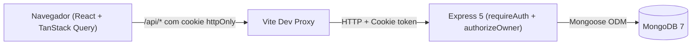

# car-hub

> Diário de bordo automotivo (*vehicle logbook*) para registrar manutenções, reparos e preparações, acompanhar o custo real por veículo e controlar prazos de garantia sem perder comprovantes nem datas.


Trabalho prático da disciplina de **Tópicos Especiais em Programação II (UPF)** reunindo a **1ª entrega** (API REST em Node.js + TypeScript + MongoDB) e a **2ª entrega** (aplicação web em React + TypeScript) em um único repositório.

[Conceito e ideia](#conceito-e-ideia) · [Funcionalidades](#funcionalidades) · [Telas](#telas) · [Tecnologias](#tecnologias) · [Como executar](#como-executar) · [Como usar](#como-usar) · [Arquitetura e organização](#arquitetura-e-organização)


---

## Conceito e ideia

Quem cuida de um carro de uso diário ou monta um *project car* acaba espalhando o histórico em notas fiscais de papel, conversas de oficina e planilhas improvisadas. Na prática, isso gera três problemas recorrentes:

1. **Perda de histórico de manutenção:** fica difícil saber quando uma peça foi trocada ou qual era a quilometragem na época do serviço.
2. **Garantias esquecidas:** serviços e peças costumam ter garantia de 3, 6 ou 12 meses, mas raramente há visibilidade de quais estão prestes a vencer.
3. **Falta de visão financeira consolidada:** somar gastos por categoria (manutenção preventiva, reparo corretivo ou preparação) e acompanhar o custo por quilômetro rodado exige cálculo manual.

O **car-hub** centraliza essas informações em um fluxo direto: você cadastra os veículos da sua garagem e registra cada intervenção no diário de bordo do carro. A partir desses registros, o sistema calcula automaticamente a data de expiração das garantias, atualiza o odômetro do veículo quando um serviço traz quilometragem maior e consolida métricas mensais e por categoria.

### Identidade visual

A interface é inspirada nos **painéis digitais GM dos anos 90** (Monza Classic e Kadett GSi): fundo escuro grafite, visores LCD para odômetros e placas Mercosul, cluster de login interativo e iluminação em **Âmbar GM** (com opção **Verde fósforo** no menu do usuário).

---

## Funcionalidades

- **Conta e sessão persistente por cookie:** cadastro de usuário com senha criptografada (`bcryptjs`), login, logout e restauração automática de sessão via cookie `httpOnly` com JWT (não exige login a cada clique nem expõe o token ao JavaScript).
- **Visão geral (`Geral`):** painel consolidado com total investido na garagem, gastos dos últimos 30 dias, resumo de garantias (vigentes, vencendo e expiradas), comparativo proporcional por veículo, alertas de garantia e os 5 serviços mais recentes.
- **Garagem (`Carros`):** criação, edição e exclusão de veículos (marca, modelo, ano, placa no padrão brasileiro/Mercosul, quilometragem e apelido opcional), com confirmação antes de excluir e remoção em cascata dos serviços do carro.
- **Diário de serviços:** registro completo de intervenções classificadas em **Manutenção**, **Reparo**, **Preparação** ou **Outro**, com data brasileira (`dd/mm/aaaa` e calendário em português), valor em reais, quilometragem e **garantia opcional (1 a 120 meses)**.
- **Regras automáticas no backend:**
  - Cálculo exato da data de expiração da garantia em UTC (com ajuste para meses curtos e anos bissextos) e remoção da garantia caso os meses sejam apagados na edição.
  - Atualização automática do odômetro do veículo quando um serviço é lançado ou editado com quilometragem superior à atual.
- **Painel individual do carro:** custo total, **custo por km**, quantidade de serviços, ticket médio, data do último serviço, barras segmentadas por categoria, histórico dos últimos 12 meses, filtro por categoria e busca por descrição.
- **Isolamento multiusuário:** cada usuário acessa exclusivamente os próprios veículos e serviços; tentativas de acesso a recursos de terceiros respondem `404`.
- **Experiência de uso:** layout responsivo para computador e celular, skeletons de carregamento, estados vazios com atalhos de ação, validação em tempo real e notificações *toast* para sucesso e erro.

---

## Telas

| Login | Visão geral |
|---|---|
|  |  |

| Novo serviço | Detalhe do carro e diário de serviços |
|---|---|
|  |  |

---

## Tecnologias

| Camada | Tecnologias |
|---|---|
| Backend | Node.js, Express 5, TypeScript 5, MongoDB 7 com Mongoose 9, `jsonwebtoken`, `bcryptjs`, `cookie-parser`, `cors`, Swagger UI |
| Testes do backend | Jest 30, `@swc/jest` e Supertest |
| Frontend | React 19, TypeScript, Vite 8, React Router 7, TanStack Query 5, Axios, React Hook Form e Zod 4 |
| Interface | Tailwind CSS v4, shadcn/ui (Radix UI), Geist Sans & Mono, `sonner` (toasts), `lucide-react` |
| Qualidade e Infra | ESLint 9, Prettier, `oxlint`, Docker Compose (MongoDB 7 com volume persistente) |

---

## Como executar

### Pré-requisitos

- **Node.js 20+** e `npm`
- **Docker** e **Docker Compose** (para subir o MongoDB sem precisar instalar localmente)

### 1. Subir o banco de dados (MongoDB)

```bash
cd backend
docker compose up -d
```

O MongoDB sobe no container `car-hub-mongo` (porta `27017`) usando o volume nomeado `mongo-data` para manter os dados mesmo após reiniciar o container.

### 2. Configurar e iniciar o backend

```bash
cd backend
cp .env.example .env
npm install
npm run dev
```

- API disponível em `http://localhost:3000`
- Documentação interativa (Swagger) em `http://localhost:3000/docs`

> [!IMPORTANT]
> O backend exige `JWT_SECRET` definido no `backend/.env` para iniciar. O `.env.example` já traz um valor de exemplo para desenvolvimento local; em produção, substitua por uma string longa e aleatória.

### 3. Configurar e iniciar o frontend

Em **outro terminal**:

```bash
cd frontend
cp .env.example .env
npm install
npm run dev
```

Acesse **`http://localhost:5173`**. Em desenvolvimento, o Vite encaminha todas as requisições `/api/*` para o endereço configurado em `VITE_API_PROXY_TARGET` (`http://localhost:3000`), mantendo o cookie de sessão na mesma origem do navegador.

### 4. Popular dados de demonstração (opcional, recomendado)

Com o MongoDB e o backend rodando, execute em um terminal:

```bash
cd backend
npm run seed
```

Esse script cria o usuário de demonstração com 2 veículos e 12 serviços distribuídos nos últimos meses (incluindo garantias vigentes, vencendo em menos de 30 dias e expiradas):

- **E-mail:** `demo@car-hub.dev`
- **Senha:** `demo1234`

---

## Variáveis de ambiente

Nenhum arquivo `.env` real é versionado no repositório. Os modelos prontos estão em `backend/.env.example` e `frontend/.env.example`.

### `backend/.env` (baseado em `backend/.env.example`)

| Variável | Obrigatória | Descrição | Exemplo |
|---|---|---|---|
| `PORT` | Não (padrão `3000`) | Porta HTTP da API | `3000` |
| `MONGODB_URL` | Sim | String de conexão com o MongoDB | `mongodb://localhost:27017/car-hub` |
| `JWT_SECRET` | Sim | Chave secreta usada para assinar e validar o JWT | `change-me-to-a-long-random-string` |
| `CORS_ORIGIN` | Não (padrão `http://localhost:5173`) | Origem liberada no CORS com `credentials: true` | `http://localhost:5173` |

### `frontend/.env` (baseado em `frontend/.env.example`)

| Variável | Obrigatória | Descrição | Exemplo |
|---|---|---|---|
| `VITE_API_URL` | Não (padrão `/api`) | Prefixo base usado pelo Axios nas chamadas à API | `/api` |
| `VITE_API_PROXY_TARGET` | Não (padrão `http://localhost:3000`) | Destino do proxy `/api` no servidor de desenvolvimento Vite | `http://localhost:3000` |

---

## Como usar

1. **Entre ou crie sua conta:** acesse `http://localhost:5173`. Você pode entrar com `demo@car-hub.dev` / `demo1234` (se rodou o seed) ou clicar na aba **Cadastrar** para criar uma conta nova (que já entra autenticada).
2. **Acompanhe a visão geral (`Geral`):** veja o total investido, gastos dos últimos 30 dias, contagem de garantias, comparação entre carros e alertas de garantias vencendo ou expiradas.
3. **Gerencie seus veículos (`Carros`):** clique em **Novo carro**, preencha marca, modelo, ano, placa (7 caracteres) e quilometragem atual. Use **Editar** ou **Excluir** no rodapé do card quando precisar alterar ou remover um veículo.
4. **Registre serviços no diário:** clique no card de qualquer veículo (ou no botão **Novo serviço** na aba `Geral`), selecione a categoria, informe a data em `dd/mm/aaaa` (digitando ou pelo calendário), descrição, valor, quilometragem e meses de garantia (se houver).
5. **Filtre e analise:** dentro da tela do carro, use os botões de categoria (**Todos**, **Manutenção**, **Reparo**, **Preparação**, **Outro**) e a busca por descrição para encontrar registros, além dos gráficos de distribuição por categoria e evolução nos últimos 12 meses.
6. **Personalize ou encerre a sessão:** clique no seu nome no canto superior direito para alternar a iluminação do painel (**Âmbar GM** ↔ **Verde fósforo**) ou clicar em **Sair** (limpa o cookie da sessão e bloqueia as rotas privadas novamente).

---

## Arquitetura e organização

### Fluxo de requisição e autenticação



1. **Autenticação por cookie:** `POST /login` valida as credenciais e grava o cookie `token` (JWT válido por 7 dias, `httpOnly`, `SameSite=Lax`, `Secure` em produção).
2. **Proteção de rotas:** no frontend, `ProtectedRoute` consulta `GET /me` ao iniciar e redireciona sessões anônimas para `/login`; se alguma chamada protegida retornar `401`, o interceptor do Axios limpa o estado e redireciona com aviso. No backend, `requireAuth` valida o cookie e injeta `req.userId`, e `authorizeOwner` confirma que o recurso pertence ao usuário autenticado.
3. **Identidade pelo token:** o frontend nunca envia `userId` no corpo ou na query — toda leitura e criação de veículos usa o identificador extraído do JWT.

### Rotas da API

Documentação OpenAPI 3.0 completa e testável diretamente em `http://localhost:3000/docs`.

| Método e rota | Acesso | Descrição |
|---|---|---|
| `GET /health` | Público | Verifica se a API está no ar |
| `POST /users` | Público | Cadastra novo usuário |
| `POST /login` | Público | Autentica e grava o cookie `token` |
| `POST /logout` | Público | Limpa o cookie de sessão |
| `GET /me` | Cookie | Retorna o usuário autenticado na sessão |
| `GET /dashboard` | Cookie | Consolida gastos, alertas de garantia e últimos 5 serviços |
| `GET`, `POST /cars` | Cookie | Lista e cria carros do usuário |
| `GET`, `PUT`, `DELETE /cars/:id` | Cookie + Dono | Consulta, atualiza ou exclui um carro (e seus serviços) |
| `GET /cars/:id/summary` | Cookie + Dono | Resumo do carro (totais, custo/km, categorias e últimos 12 meses) |
| `GET`, `POST /service-records` | Cookie + Dono | Lista (`?carId=`) e cria registros de serviço |
| `GET`, `PUT`, `DELETE /service-records/:id` | Cookie + Dono | Consulta, atualiza ou exclui um serviço |

### Estrutura de pastas

```text
car-hub/
├── backend/
│   ├── docker-compose.yml        MongoDB 7 com volume persistente
│   ├── .env.example              Modelo das variáveis de ambiente da API
│   ├── bruno/                    Coleção Bruno pronta para testar os endpoints
│   ├── tests/                    Testes unitários e de integração (services, middlewares, routes)
│   └── src/
│       ├── routes/               Definição de rotas e encadeamento de middlewares
│       ├── controllers/          Tradução HTTP (status, params, cookies)
│       ├── services/             Regras de negócio (garantia, métricas, dashboard, senha)
│       ├── repositories/         Consultas e persistência no MongoDB
│       ├── models/               Schemas e normalização JSON do Mongoose
│       ├── middlewares/          Validação de entrada, autenticação JWT e autorização de dono
│       ├── config/               Conexão com banco, configuração de cookie/JWT e Swagger
│       ├── scripts/              Script `seed` para popular dados de demonstração
│       ├── errors/               Classes e tratamento de erros HTTP
│       └── utils/                Token JWT, normalização de placa, datas e métricas
├── frontend/
│   ├── .env.example              Modelo das variáveis de ambiente do frontend
│   └── src/
│       ├── pages/                LoginPage, RegisterPage, DashboardPage, CarsPage, CarDetailPage, NotFoundPage
│       ├── components/           Componentes reutilizáveis (layout/, auth/, ui/ shadcn)
│       ├── services/             Cliente Axios, tradução de erros e chamadas por domínio
│       ├── hooks/                Queries/mutações (TanStack Query), tema e telemetria do login
│       ├── contexts/             AuthProvider (sessão global via `/me`)
│       ├── lib/                  Formatadores (BRL, data dd/mm/aaaa, placa), validação e regras de garantia
│       └── types/                Tipagem TypeScript espelhando os contratos da API
└── docs/
    ├── ROTEIRO-DEMO.md           Roteiro sugerido para apresentação ao vivo
    └── screenshots/              Capturas de tela exibidas neste README
```

### Organização por camadas e Atomic Design

- **Backend em camadas:** cada responsabilidade fica isolada (`routes → middlewares → controllers → services → repositories → models`), mantendo regras de negócio testáveis sem depender do Express ou do banco em memória.
- **Frontend em páginas, componentes e serviços (Atomic Design):**
  - **Átomos:** `components/ui/*` (shadcn/ui), `Wordmark`, `SegmentedBar`, `SevenSegmentChar`.
  - **Moléculas:** `MetricCard`, `PageHeader`, `LicensePlate`, `OdometerDisplay`, `WarrantyBadge`, `DateInput`, `AuthField`, `AuxBarRow`, `RightTachometer`.
  - **Organismos:** `SummaryCards`, `SpentByTypeChart`, `MonthlySpentChart`, `CarFormDialog`, `ServiceRecordFormDialog`.
  - **Templates e Páginas:** `AppLayout`, `MonzaAuthCluster` e `pages/*`.

---

## Testes e qualidade

### Backend

```bash
cd backend
npm test
```

- **Suíte automatizada:** **202 testes em 11 suítes** cobrindo regras de serviço, cálculo de garantia, validação de campos, autenticação por cookie, acesso sem sessão e isolamento entre usuários (repositórios simulados com `jest.mock`, sem precisar do Docker ligado).
- **Outros comandos:** `npm run test:coverage`, `npm run lint`, `npm run format:check` e `npm run build`.

### Frontend

```bash
cd frontend
npm run lint
npm run build
```

---

## Solução de problemas comuns

| Problema | Causa provável | Como resolver |
|---|---|---|
| Backend fecha logo ao iniciar com erro de `JWT_SECRET` | Falta o arquivo `.env` ou a variável `JWT_SECRET` | Rode `cp .env.example .env` dentro de `backend/` |
| Erro de conexão com o MongoDB ao rodar `npm run dev` | Container do banco parado | Rode `docker compose up -d` dentro de `backend/` |
| Frontend mostra *"Não foi possível falar com o servidor"* | Backend desligado ou porta errada | Confirme `npm run dev` rodando na porta `3000` e `VITE_API_PROXY_TARGET` no `frontend/.env` |
| Conta `demo@car-hub.dev` não entra ou aparece vazia | Script de seed ainda não foi executado | Com backend e MongoDB no ar, rode `cd backend && npm run seed` |
