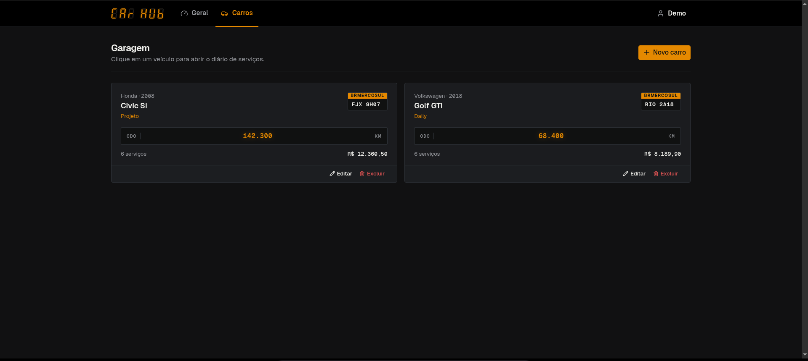
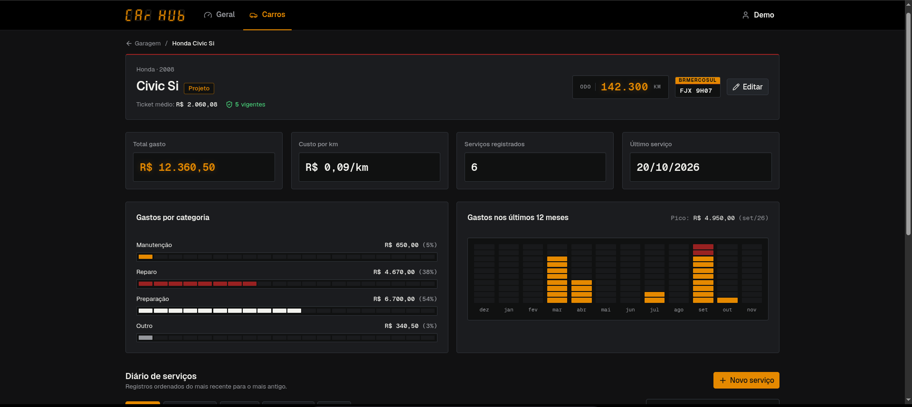
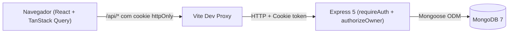

# car-hub

Diário de bordo automotivo para registrar manutenções, reparos e preparações, acompanhar o custo por veículo e controlar prazos de garantia.


Trabalho da disciplina **Tópicos Especiais II**.

[Problema](#problema-e-proposta) · [Funcionalidades](#funcionalidades) · [Telas](#telas) · [Tecnologias](#tecnologias) · [Como executar](#como-executar) · [Como usar](#como-usar) · [Arquitetura](#arquitetura-e-organização)



---

## Problema e proposta

O histórico de um carro costuma ficar espalhado entre notas fiscais de papel, conversas de oficina e planilhas. Isso causa três problemas:

1. **Histórico de manutenção perdido:** não se sabe quando uma peça foi trocada nem a quilometragem na época.
2. **Garantias esquecidas:** serviços e peças têm garantia de 3, 6 ou 12 meses, mas não há visibilidade do que está perto de vencer.
3. **Sem visão financeira consolidada:** somar gastos por categoria e calcular o custo por quilômetro exige conta manual.

No car-hub, o usuário cadastra os veículos da garagem e registra cada intervenção no diário do carro. O sistema calcula a data de expiração das garantias, atualiza o odômetro quando um serviço traz quilometragem maior e consolida métricas mensais e por categoria.

### Identidade visual

A interface se inspira nos painéis digitais GM dos anos 90 (Monza Classic e Kadett GSi): fundo grafite, visores LCD para odômetro e placa Mercosul, cluster de login interativo e iluminação em **Âmbar GM**, com opção de **Verde fósforo** no menu do usuário.

---

## Funcionalidades

- **Conta e sessão:** cadastro com senha criptografada (`bcryptjs`), login, logout e restauração de sessão por cookie `httpOnly` com JWT, sem expor o token ao JavaScript.
- **Visão geral (`Geral`):** total investido, gastos dos últimos 30 dias, resumo de garantias (vigentes, vencendo e expiradas), comparativo entre veículos, alertas de garantia e os 5 serviços mais recentes.
- **Garagem (`Carros`):** CRUD de veículos (marca, modelo, ano, placa no padrão brasileiro/Mercosul, quilometragem e apelido opcional). A exclusão pede confirmação e remove em cascata os serviços do carro.
- **Diário de serviços:** registros classificados em **Manutenção**, **Reparo**, **Preparação** ou **Outro**, com data (`dd/mm/aaaa`, calendário em português), valor em reais, quilometragem e garantia opcional de 1 a 120 meses.
- **Regras automáticas no backend:**
  - Cálculo da data de expiração da garantia em UTC, com ajuste para meses curtos e anos bissextos. Se os meses forem apagados na edição, a garantia é removida.
  - Atualização do odômetro do veículo quando um serviço é criado ou editado com quilometragem acima da atual.
- **Painel do carro:** custo total, custo por km, quantidade de serviços, ticket médio, data do último serviço, distribuição por categoria, histórico dos últimos 12 meses, filtro por categoria e busca por descrição.
- **Isolamento entre usuários:** cada usuário acessa apenas os próprios veículos e serviços. Acesso a recursos de terceiros retorna `404`.
- **Interface:** layout responsivo, skeletons de carregamento, estados vazios com atalhos, validação em tempo real e notificações *toast*.

---

## Telas

| Login | Visão geral |
|---|---|
|  |  |

| Novo serviço | Detalhe do carro |
|---|---|
|  |  |

---

## Tecnologias

| Camada | Tecnologias |
|---|---|
| Backend | Node.js, Express 5, TypeScript 5, MongoDB 7 com Mongoose 9, `jsonwebtoken`, `bcryptjs`, `cookie-parser`, `cors`, Swagger UI |
| Testes do backend | Jest 30, `@swc/jest`, Supertest |
| Frontend | React 19, TypeScript, Vite 8, React Router 7, TanStack Query 5, Axios, React Hook Form, Zod 4 |
| Interface | Tailwind CSS v4, shadcn/ui (Radix UI), Geist Sans e Mono, `sonner`, `lucide-react` |
| Qualidade e infra | ESLint 9, Prettier, `oxlint`, Docker Compose (MongoDB 7 com volume persistente) |

---

## Como executar

### Pré-requisitos

- Node.js 20+ e `npm`
- Docker e Docker Compose (para o MongoDB)

### 1. Banco de dados

```bash
cd backend
docker compose up -d
```

O MongoDB sobe no container `car-hub-mongo` (porta `27017`) com o volume `mongo-data`, que preserva os dados entre reinicializações.

### 2. Backend

```bash
cd backend
cp .env.example .env
npm install
npm run dev
```

- API: `http://localhost:3000`
- Swagger: `http://localhost:3000/docs`

> [!IMPORTANT]
> O backend só inicia com `JWT_SECRET` definido em `backend/.env`. O `.env.example` traz um valor para desenvolvimento local; em produção, use uma string longa e aleatória.

### 3. Frontend

Em outro terminal:

```bash
cd frontend
cp .env.example .env
npm install
npm run dev
```

Acesse `http://localhost:5173`. Em desenvolvimento, o Vite encaminha as requisições `/api/*` para `VITE_API_PROXY_TARGET` (`http://localhost:3000`), o que mantém o cookie de sessão na mesma origem.

### 4. Dados de demonstração (opcional)

Com o MongoDB e o backend rodando:

```bash
cd backend
npm run seed
```

O script cria um usuário de demonstração com 2 veículos e 12 serviços distribuídos nos últimos meses, incluindo garantias vigentes, vencendo em menos de 30 dias e expiradas.

- **E-mail:** `demo@car-hub.dev`
- **Senha:** `demo1234`

---

## Variáveis de ambiente

### `backend/.env`

| Variável | Obrigatória | Descrição | Exemplo |
|---|---|---|---|
| `PORT` | Não (padrão `3000`) | Porta HTTP da API | `3000` |
| `MONGODB_URL` | Sim | String de conexão com o MongoDB | `mongodb://localhost:27017/car-hub` |
| `JWT_SECRET` | Sim | Chave para assinar e validar o JWT | `change-me-to-a-long-random-string` |
| `CORS_ORIGIN` | Não (padrão `http://localhost:5173`) | Origem liberada no CORS com `credentials: true` | `http://localhost:5173` |

### `frontend/.env`

| Variável | Obrigatória | Descrição | Exemplo |
|---|---|---|---|
| `VITE_API_URL` | Não (padrão `/api`) | Prefixo base do Axios nas chamadas à API | `/api` |
| `VITE_API_PROXY_TARGET` | Não (padrão `http://localhost:3000`) | Destino do proxy `/api` no servidor de desenvolvimento | `http://localhost:3000` |

---

## Como usar

1. **Acesso:** abra `http://localhost:5173`. Entre com `demo@car-hub.dev` / `demo1234` (se rodou o seed) ou crie uma conta na aba **Cadastrar**, que já entra autenticada.
2. **Visão geral (`Geral`):** consulte o total investido, os gastos dos últimos 30 dias, a contagem de garantias, a comparação entre carros e os alertas de garantia.
3. **Veículos (`Carros`):** clique em **Novo carro** e informe marca, modelo, ano, placa (7 caracteres) e quilometragem. **Editar** e **Excluir** ficam no rodapé de cada card.
4. **Serviços:** clique no card de um veículo, ou em **Novo serviço** na aba `Geral`. Informe categoria, data (`dd/mm/aaaa`, digitada ou pelo calendário), descrição, valor, quilometragem e meses de garantia, se houver.
5. **Filtros e análise:** na tela do carro, filtre por categoria (**Todos**, **Manutenção**, **Reparo**, **Preparação**, **Outro**), busque por descrição e consulte os gráficos de distribuição por categoria e de evolução nos últimos 12 meses.
6. **Menu do usuário:** o nome no canto superior direito alterna a iluminação do painel (**Âmbar GM** e **Verde fósforo**) e dá acesso ao **Sair**, que limpa o cookie e bloqueia as rotas privadas.

---

## Arquitetura e organização

### Fluxo de requisição e autenticação



1. **Cookie de sessão:** `POST /login` valida as credenciais e grava o cookie `token` (JWT de 7 dias, `httpOnly`, `SameSite=Lax`, `Secure` em produção).
2. **Proteção de rotas:**
   - No frontend, `ProtectedRoute` consulta `GET /me` ao iniciar e redireciona sessões anônimas para `/login`. Se uma chamada protegida retornar `401`, o interceptor do Axios limpa o estado e redireciona com aviso.
   - No backend, `requireAuth` valida o cookie e injeta `req.userId`; `authorizeOwner` confirma que o recurso pertence ao usuário autenticado.
3. **Identidade pelo token:** o frontend não envia `userId` no corpo nem na query. O identificador vem sempre do JWT.

### Rotas da API

A documentação OpenAPI 3.0 está em `http://localhost:3000/docs` e permite testar as rotas diretamente.

| Método e rota | Acesso | Descrição |
|---|---|---|
| `GET /health` | Público | Verifica se a API está no ar |
| `POST /users` | Público | Cadastra usuário |
| `POST /login` | Público | Autentica e grava o cookie `token` |
| `POST /logout` | Público | Limpa o cookie de sessão |
| `GET /me` | Cookie | Retorna o usuário autenticado |
| `GET /dashboard` | Cookie | Gastos, alertas de garantia e últimos 5 serviços |
| `GET`, `POST /cars` | Cookie | Lista e cria carros do usuário |
| `GET`, `PUT`, `DELETE /cars/:id` | Cookie + Dono | Consulta, atualiza ou exclui um carro e seus serviços |
| `GET /cars/:id/summary` | Cookie + Dono | Totais, custo/km, categorias e últimos 12 meses |
| `GET`, `POST /service-records` | Cookie + Dono | Lista (`?carId=`) e cria registros de serviço |
| `GET`, `PUT`, `DELETE /service-records/:id` | Cookie + Dono | Consulta, atualiza ou exclui um serviço |

### Estrutura de pastas

```text
car-hub/
├── backend/
│   ├── docker-compose.yml        MongoDB 7 com volume persistente
│   ├── .env.example              Modelo das variáveis de ambiente da API
│   ├── bruno/                    Coleção Bruno para testar os endpoints
│   ├── tests/                    Testes unitários e de integração (services, middlewares, routes)
│   └── src/
│       ├── routes/               Rotas e encadeamento de middlewares
│       ├── controllers/          Tradução HTTP (status, params, cookies)
│       ├── services/             Regras de negócio (garantia, métricas, dashboard, senha)
│       ├── repositories/         Consultas e persistência no MongoDB
│       ├── models/               Schemas e normalização JSON do Mongoose
│       ├── middlewares/          Validação de entrada, autenticação JWT e autorização de dono
│       ├── config/               Conexão com o banco, cookie/JWT e Swagger
│       ├── scripts/              Script `seed` com dados de demonstração
│       ├── errors/               Classes e tratamento de erros HTTP
│       └── utils/                Token JWT, normalização de placa, datas e métricas
├── frontend/
│   ├── .env.example              Modelo das variáveis de ambiente do frontend
│   └── src/
│       ├── pages/                LoginPage, RegisterPage, DashboardPage, CarsPage, CarDetailPage, NotFoundPage
│       ├── components/           Componentes reutilizáveis (layout/, auth/, ui/ shadcn)
│       ├── services/             Cliente Axios, tradução de erros e chamadas por domínio
│       ├── hooks/                Queries e mutações (TanStack Query), tema e telemetria do login
│       ├── contexts/             AuthProvider (sessão global via `/me`)
│       ├── lib/                  Formatadores (BRL, data, placa), validação e regras de garantia
│       └── types/                Tipos TypeScript dos contratos da API
└── docs/
    ├── ROTEIRO-DEMO.md           Roteiro para apresentação ao vivo
    └── screenshots/              Capturas de tela usadas neste README
```

### Camadas e Atomic Design

- **Backend em camadas:** `routes → middlewares → controllers → services → repositories → models`. As regras de negócio ficam em `services`, testáveis sem Express nem banco.
- **Frontend (Atomic Design):**
  - **Átomos:** `components/ui/*` (shadcn/ui), `Wordmark`, `SegmentedBar`, `SevenSegmentChar`.
  - **Moléculas:** `MetricCard`, `PageHeader`, `LicensePlate`, `OdometerDisplay`, `WarrantyBadge`, `DateInput`, `AuthField`, `AuxBarRow`, `RightTachometer`.
  - **Organismos:** `SummaryCards`, `SpentByTypeChart`, `MonthlySpentChart`, `CarFormDialog`, `ServiceRecordFormDialog`.
  - **Templates e páginas:** `AppLayout`, `MonzaAuthCluster` e `pages/*`.

---

## Testes e qualidade

### Backend

```bash
cd backend
npm test
```

A suíte tem **202 testes em 11 suítes**: regras de serviço, cálculo de garantia, validação de campos, autenticação por cookie, acesso sem sessão e isolamento entre usuários. Os repositórios são simulados com `jest.mock`, então o Docker não precisa estar ligado.

Outros comandos: `npm run test:coverage`, `npm run lint`, `npm run format:check` e `npm run build`.

### Frontend

```bash
cd frontend
npm run lint
npm run build
```

---

## Solução de problemas

| Problema | Causa provável | Solução |
|---|---|---|
| Backend encerra ao iniciar com erro de `JWT_SECRET` | Falta o `.env` ou a variável `JWT_SECRET` | Rode `cp .env.example .env` em `backend/` |
| Erro de conexão com o MongoDB no `npm run dev` | Container do banco parado | Rode `docker compose up -d` em `backend/` |
| Frontend exibe "Não foi possível falar com o servidor" | Backend desligado ou porta errada | Confirme o `npm run dev` na porta `3000` e o `VITE_API_PROXY_TARGET` em `frontend/.env` |
| `demo@car-hub.dev` não entra ou aparece vazia | Seed não executado | Com backend e MongoDB no ar, rode `cd backend && npm run seed` |
