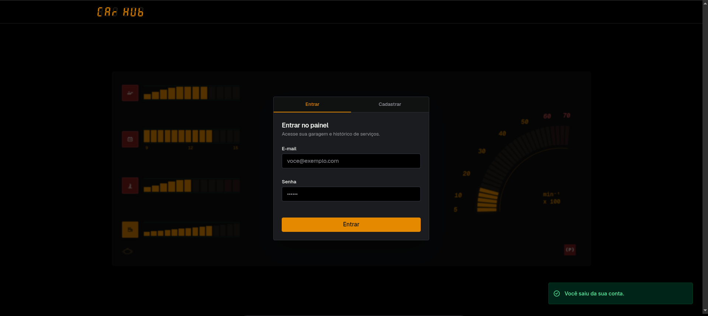
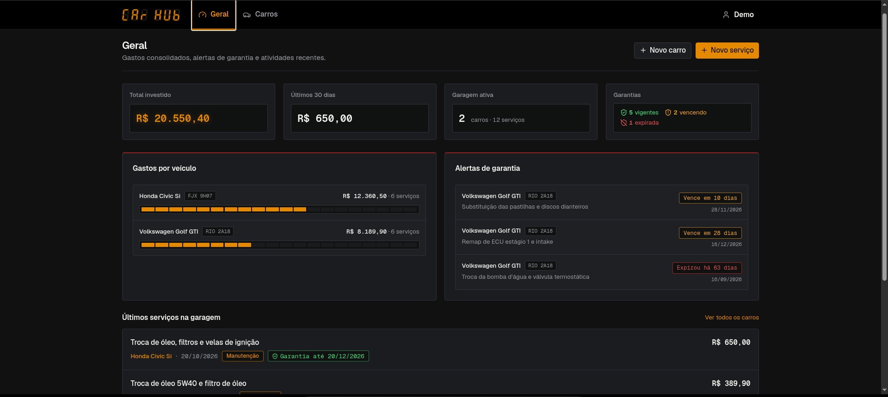
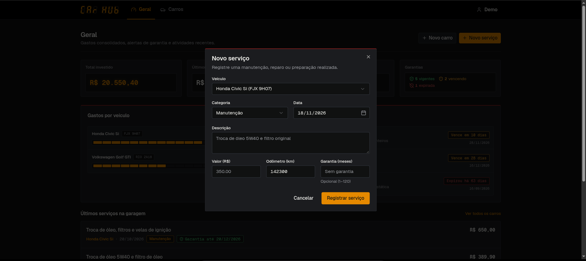

# car-hub

Diário de bordo automotivo para registrar os serviços feitos nos seus carros (manutenções, reparos e preparações), acompanhar quanto você gastou e controlar o prazo das garantias.

Trabalho prático de Tópicos Especiais em Programação II (UPF): **1ª entrega** (API) e **2ª entrega** (frontend), no mesmo repositório.


## Funcionalidades

- **Conta e sessão:** cadastro, login e logout. A sessão fica em um cookie `httpOnly` com JWT, então não é preciso entrar a cada clique.
- **Visão geral:** painel inicial consolidado com total investido na garagem, gastos nos últimos 30 dias, comparação por veículo, alertas de garantias vencendo/expiradas e os últimos serviços.
- **Garagem:** cadastro, edição e exclusão de carros, com placa no padrão Mercosul e odômetro atualizado automaticamente quando um serviço registra quilometragem maior.
- **Diário de serviços:** registro de manutenção, reparo, preparação ou outro serviço, com data, valor, quilometragem e **garantia opcional em meses**. O backend calcula a data de expiração.
- **Garantia:** cada serviço mostra se a garantia está vigente, vencendo (30 dias ou menos) ou expirada.
- **Resumo por carro:** total gasto, custo por km, quantidade de serviços, data do último serviço, gasto por categoria e gráfico dos últimos 12 meses.
- **Isolamento por usuário:** cada pessoa só enxerga os próprios carros e serviços.
- **Interface:** tema escuro inspirado em painéis digitais GM dos anos 90 (grafite fosco, visores preto profundo e destaque âmbar com detalhes em vermelho e branco), responsiva para computador e celular.

## Telas

| Login | Visão geral |
|---|---|
|  |  |

| Novo serviço | Detalhe do carro |
|---|---|
|  |  |

## Tecnologias

| Camada | Tecnologias |
|---|---|
| Backend | Node.js, Express 5, TypeScript, MongoDB 7 com Mongoose 9, JWT (`jsonwebtoken`), `bcryptjs`, Swagger UI |
| Testes do backend | Jest 30, `@swc/jest` e Supertest |
| Frontend | React 19, TypeScript, Vite, React Router, TanStack Query, axios, react-hook-form e zod |
| Interface | Tailwind CSS v4, shadcn/ui, Geist (Sans e Mono), sonner (notificações), lucide-react |
| Infra | Docker Compose (MongoDB com volume persistente) |

## Como executar

### Pré-requisitos

- Node.js 20 ou superior
- Docker e Docker Compose

### 1. Banco de dados

```bash
cd backend
docker compose up -d
```

O MongoDB sobe no container `car-hub-mongo` (porta 27017), com o volume `mongo-data` para manter os dados.

### 2. Backend

```bash
cd backend
cp .env.example .env
npm install
npm run dev
```

- API: `http://localhost:3000`
- Swagger: `http://localhost:3000/docs`

Troque o `JWT_SECRET` do `.env` por um valor longo e aleatório. O servidor não sobe sem ele.

### 3. Frontend

Em outro terminal:

```bash
cd frontend
cp .env.example .env
npm install
npm run dev
```

Acesse `http://localhost:5173`. O Vite repassa as chamadas `/api/*` para o backend, então o cookie de sessão funciona sem configurar CORS.

### 4. Dados de demonstração (opcional)

Com o backend rodando:

```bash
cd backend
npm run seed
```

Cria o usuário `demo@car-hub.dev` (senha `demo1234`) com 2 carros e 12 serviços, incluindo garantias vigentes, vencendo e expiradas.

## Variáveis de ambiente

### `backend/.env` (modelo em `backend/.env.example`)

| Variável | Descrição | Exemplo |
|---|---|---|
| `PORT` | Porta da API | `3000` |
| `MONGODB_URL` | Conexão com o MongoDB | `mongodb://localhost:27017/car-hub` |
| `JWT_SECRET` | Segredo que assina o JWT (obrigatório) | `change-me-to-a-long-random-string` |
| `CORS_ORIGIN` | Origem do frontend liberada no CORS | `http://localhost:5173` |

### `frontend/.env` (modelo em `frontend/.env.example`)

| Variável | Descrição | Exemplo |
|---|---|---|
| `VITE_API_URL` | Prefixo usado pelo frontend para chamar a API | `/api` |
| `VITE_API_PROXY_TARGET` | Endereço do backend usado pelo proxy do Vite | `http://localhost:3000` |

## Como usar

1. Abra `http://localhost:5173` e crie uma conta (ou entre com o usuário demo).
2. Na **Garagem**, clique em **Novo carro** e informe marca, modelo, ano, placa e quilometragem.
3. Abra o carro em **Diário** e clique em **Novo serviço**.
4. Informe categoria, data, descrição, valor e quilometragem. Se houver garantia, preencha os meses.
5. Acompanhe o total gasto, os gastos por categoria e o estado de cada garantia. Use o filtro por categoria para achar um serviço.
6. Edite ou exclua carros e serviços pelos ícones. Excluir um carro apaga também os serviços dele.
7. Para sair, use o menu com seu nome no canto superior direito e escolha **Sair**.

## Autenticação

`POST /login` valida as credenciais e grava o cookie `token` (JWT de 7 dias, `httpOnly`, `SameSite=Lax`). As rotas de carros, serviços e `GET /me` exigem esse cookie. Sem ele, a API responde 401 e o frontend leva para a tela de login. Carros e serviços de outro usuário respondem 404.

## Rotas da API

Documentação completa e testável em `http://localhost:3000/docs`.

| Rota | Descrição |
|---|---|
| `POST /users` | Cadastra usuário |
| `POST /login` | Entra e grava o cookie de sessão |
| `POST /logout` | Encerra a sessão |
| `GET /me` | Usuário da sessão |
| `GET /dashboard` | Visão geral consolidada (gastos, alertas de garantia e últimos serviços) |
| `GET`, `POST /cars` | Lista e cria carros do usuário |
| `GET`, `PUT`, `DELETE /cars/:id` | Consulta, atualiza e exclui um carro |
| `GET /cars/:id/summary` | Resumo de gastos do carro (totais, custo/km e últimos 12 meses) |
| `GET`, `POST /service-records` | Lista (`?carId=`) e cria serviços |
| `GET`, `PUT`, `DELETE /service-records/:id` | Consulta, atualiza e exclui um serviço |
| `GET /health` | Verifica se a API está no ar |

## Testes

```bash
cd backend
npm test
```

Os testes usam repositórios simulados, então não precisam do Docker. Cobrem o CRUD, a validação de dados, o login, o cookie, o acesso sem sessão e o isolamento entre usuários. Outros comandos: `npm run test:coverage`, `npm run lint` e `npm run format:check`.

No frontend: `npm run lint` e `npm run build`.

## Estrutura do projeto

```
car-hub/
├── backend/
│   ├── docker-compose.yml
│   ├── .env.example
│   └── src/
│       ├── routes/        rotas e proteção por login
│       ├── controllers/   tradução HTTP
│       ├── services/      regras de negócio (garantia, resumo, senha)
│       ├── repositories/  acesso ao MongoDB
│       ├── models/        schemas do Mongoose
│       ├── middlewares/   validação, autenticação e dono do recurso
│       ├── config/        banco, autenticação e Swagger
│       ├── scripts/       seed de demonstração
│       └── ...            types, errors, utils
├── frontend/
│   ├── .env.example
│   └── src/
│       ├── pages/         Login, Cadastro, Visão geral, Garagem, Detalhe do carro
│       ├── components/    interface reutilizável (ui/ é o shadcn)
│       ├── services/      chamadas HTTP (axios)
│       ├── hooks/         consultas e mutações (TanStack Query)
│       ├── contexts/      sessão do usuário
│       └── lib/           formatadores e regras de apresentação
└── docs/screenshots/      imagens deste README
```

## Decisões de projeto

- **Cookie `httpOnly` com JWT:** o token não fica acessível ao JavaScript, o que reduz o risco de roubo por XSS.
- **Proxy do Vite:** o navegador fala só com a origem do frontend, e o cookie funciona sem configuração extra de CORS.
- **Dono pelo token:** o backend usa o id do usuário do JWT, e o frontend nunca envia `userId`.
- **Tema escuro (GM anos 90):** profundidade em três planos (fundo `#08090a`, painéis grafite `#141619` e visores/badges recuados em `#070809`), destaque âmbar e detalhes em vermelho escuro e branco, com alternância para verde fósforo no menu do usuário (canto superior direito).
- **Atomic Design no frontend:** componentes divididos em Átomos (`ui/*`, `Wordmark`, `SegmentedBar`, `SevenSegmentChar`), Moléculas (`MetricCard`, `PageHeader`, `LicensePlate`, `OdometerDisplay`, `WarrantyBadge`, `DateInput`, `AuthField`, `AuxBarRow`, `RightTachometer`), Organismos (`SummaryCards`, `SpentByTypeChart`, `MonthlySpentChart`, `CarFormDialog`, `ServiceRecordFormDialog`), Templates (`AppLayout`, `MonzaAuthCluster`) e Páginas (`pages/*`).
- **Camadas no backend** (rotas, controllers, services, repositories e models) e **páginas, componentes e serviços no frontend**, para manter cada arquivo pequeno e fácil de achar.
